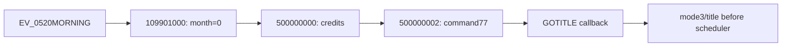

# Reverse-engineering notes

## Complete scenario executable

Source identity: `project.json`; tool revisions: `upstreams.json`.

- ELF64, big-endian PS3 executable. Scenario index begins at file offset `0xEE8B4`; each entry has four big-endian 32-bit fields: name pointer, compressed-data virtual pointer, uncompressed size, slot size.
- Complete raw scan: **1,884 scenario entries**, **1,009 with structured text**, **153,503 logical units**, **278,972 structured items**, **182,111 editable text records**, **32,929 explicit control records**. These are extraction counts, not translated coverage or confirmed route counts.
- Initial upstream extraction silently skipped 60 continuation/multi-chunk scenarios. Project `tools/scenario_source.py` now decodes flags/low-24-bit lengths and validates every entry instead of skipping errors. `tools/project.py recover` added omitted files while preserving existing translations. Detailed evidence: `../rebuild-capacity.md`.
- Each embedded chunk starts with a big-endian flag/length word followed by LZMA-ALONE; continuation `0x80`, final `0x00`, 32 KiB uncompressed chunk size, four-byte chunk padding. Original scenario arena: `0x29F000`–`0x639CF8`, within a file-backed load segment.
- Actual native names are retained separately from generated filenames. `script_0000.json` is `010301000`; exact-name correspondence also exists in the PC Ittaku archive. The user's first-New-Game screenshot matches its first two text items (alarm-clock/waking-up narration), confirming baseline opening reachability. Evidence: `work/qa/observations/new-game-opening.json`. This is not a probe build or English runtime/layout pass.
- CP932/Windows-31J with PUA glyphs. Scenario header is 16 bytes; label entries are 0x24 bytes, followed by bytecode. Text opcode: `02 0B 00 0A`.
- Structured JSON preserves editable `text`, explicit non-editable `control_text`, and raw `opcode_gap`. Edit only `translated_text`; retain source, suffixes, inline controls and ordering.
- Before complete manual acceptance, production retains fixed original slots/no record growth. The guarded `tools/production_engine.py` implementation copies the complete accepted-control native template and appends all 1,884 scenarios at 64-byte starts only after complete evidence validates. Every output payload is verified. Source-only `identity` roundtrips all 1,009 primary message files exactly; offline `smoke` now re-extracts both message and companion-choice markers without enabling production.
- `build/growth-probe/` separately experiments with actual record growth and bounded all-entry repacking; it is not a production growth cutover. Runtime VM control-flow, alignment, display and save behavior remain unverified.

## Recovered assets and fonts

The installation remains read-only. Installed `data.sdat` has an NPD header. Standalone pinned `make_npdata` recovered it into `work/assets/data.dat` without running RPCS3: **3,516 entries**, 2,180,935,968 bytes. `tools/assets.py` enforces integrity messages, output size and hashes; original source hash remained unchanged.

The kit's DAT reader and dedicated TPL decoder recovered `_initial/font.tpl` and `font1.tpl`–`font3.tpl` plus per-channel images. The main atlas visibly contains Latin letters/digits/punctuation. Stored pixels do not prove the engine's ASCII lookup, font choice or advance widths. See `../fonts.md`.

Voice/PAM movies, graphical UI, native-code strings and unmodeled text inside opcode gaps remain outside the editable inventory. The source-bound command `0x22` companion extraction below now covers native choice captions previously hidden in those gaps. No graphical edits or replacement fonts are installed.

## Scene and QA artifacts

`tools/scene_catalog.py` emits every native name, header labels, opening Japanese and exact-name PC reference candidates to `work/scenes/catalog.json`. There are 750 names with decoded PC reference entries. Route labels remain deliberately unset; numeric names and VNDB memberships do not prove main-game/AnotherDays routing.

Both historical probes failed: `build/qa-probe/` lost Q02 and long tails; `build/flow-probe/` still lost F02/F08 and post-newline tails despite exact serialized bytes and preserved controls. The current `build/native-flow-probe/` retains that failed script and original fonts, changing only the branch at VA `0x6E64C` / file `0x5E64C`, `4082038c` → `4082fccc` (`bne 0x6E9D8` → `bne 0x6E318`). `build/growth-probe/` remains a separate record-growth/relocation experiment.

Renderer `0x6DF90` tracks remaining bytes in `r20`, current consumption in `r25`, pending-span start in `r15`, and flush flag in `r24`. Two-byte characters pass `0x6E318`'s `remaining-consumed <= 0` test; ordinary single-byte characters bypass it. At `0x6EC50`, a zero flush flag skips span submission, then `0x6F0AC` exits when remaining bytes reach zero. The missing text therefore need not reach the drawing helper at all. Newline/wait/page commands explicitly flush; that explains visible pre-newline text and suffixed F10/F12 versus missing unsuffixed F09/F11.

The candidate reuses the existing terminal check rather than forcing emission on every character. It preserves `'*'` substitution dispatch and existing controls; it does not claim a fix for every inline-control/name path or line-width problem. `r3`, CR0 and XER carry changed by the reused block are overwritten before downstream consumption; vector-copy setup is equivalent on the ordinary and terminal paths.

Reproduce the source-pinned disassembly and optional integer branch replay:

```console
# Optional RE dependencies, separate from normal build requirements:
python -m pip install capstone==5.0.7 unicorn==2.1.4
python -X utf8 tools/native_text_audit.py --scalar-smoke --advance-smoke
```

The ten scalar cases cover original/patched terminal and nonterminal decisions and retaining an existing flush. Unicorn cannot execute the needed vector copies; only those copies are NOPed in **scratch RAM**, and replay stops before common cursor/emission processing. The staged ELF does not contain those NOPs. This is not complete renderer/GPU/VM or emulator proof. Evidence: `work/qa/text-renderer-audit.json` and `work/qa/native-flow-comparison.json`. Manual acceptance remains required: `../pretranslation-gates.md`.

## ASCII advance mismatch — 2026-10-24

The user's terminal-flush screenshots restore the missing spans but retain F09's Japanese overlap and the F02/F08 flower overlap. Source tracing identifies two different width policies, not a scalar/vector cursor-store disagreement.

Let `C` be the scanner context, `W=C[0x94]` its cell width, `S=C[0xA4]` its horizontal glyph scale, and `T=C[0x84]` its position transform. The normal font constructor at `0x798BC–0x798CC` supplies a 48-unit cell; `0x70D18–0x70D64` copies that dimension into the scanner.

- Scanner: `0x6F014–0x6F034` advances logical X by `W*S*visible_bytes*0.5`. The vector path commits the same ordinary-span result at `0x6F060`; its unaligned loads are Cell `lvlx`, not aligned-down `lvx`. Following fragments reload this X at `0x6E0D0`.
- Drawing: `0x6DAFC` captures the span; `0x704B0` later calls glyph-packet builder `0x594E8`. For an ASCII metric pair `(a,b)`, `0x59918–0x59934` shifts the glyph origin by `-(a-3)*T*S`, then `0x59A58–0x59ACC` adds `(a+b+3)*T*S`. **Net pen advance is `(b+6)*T*S`**, not half a cell and not `(a+b+3)*T*S`. Two-byte characters retain the full-cell advance `W*T*S`.
- Font data: `0x1183C` attaches the original metric pairs at VA `0x257038`. The constructor at `0x1AF60` builds 97 code ranges / 7,402 glyph indices from pointer pairs at VA `0xEA430`. Lookup `0x1D538` maps printable ASCII through VA `0x2614B0`, then returns the indexed metric pair. The ASCII table contains CP932 character mappings, not widths.
- Flower: span byte length becomes floating progress count `span[0x14BC]`. Completed endpoints at `0x706CC–0x706E0`, wait/final endpoints at `0x70530–0x70548` / `0x70630–0x70648`, and repositioning at `0x6F988–0x6F9B8` independently apply the half-byte formula. Flower placement calls `0x55C18`; it does not obtain the actual glyph endpoint or rely solely on `C[0x54]`.

Using the actual original metric pairs, with `W=48`, `S=T=1` and a zero starting pen:

| Diagnostic text | Drawing advance | Scanner / flower advance | Cursor shortfall |
| --- | ---: | ---: | ---: |
| `[F09] OK` | 231 | 192 | 39 |
| `[F02] abcdefgh` | 399 | 336 | 63 |
| `[F08] END` | 264 | 216 | 48 |
| `[F11] OK` | 195 | 192 | 3 |

These are source-derived **unit-scale pen calculations**, not measured screenshot pixels or a visible-ink-bound guarantee. They explain why F09 and F11 need not overlap equally despite equal byte length.

`--advance-smoke` executes all 95 printable-ASCII metric lookups against source-backed mapping/range/metric data. Unicorn traps on four 64-bit index operations; scratch RAM substitutes equivalent bounded 32-bit `rlwinm` operations, recorded in the audit. Inputs and addresses remain below `2**32`. The initialized-table path is replayed; first-lookup fallback initialization is not. Floating-point/vector pen arithmetic is modeled from disassembly, **not executed**; isolated floating-point replay trapped. No GPU, VM, complete renderer or RPCS3 result is claimed.

The new diagnostic below makes those measurements consistent while retaining original drawing. The original terminal-flush ELF remains partial-success evidence, not an active test request. No global `0.5` replacement or isolated cursor/flower offset is used.


## Source constraints carried into the metric correction

Further native review found no aligned zero/NOP run of at least 32 bytes in the executable sections. The zero padding at file `0x10E3E8–0x110000` is outside the existing executable PT_LOAD; treating it as an executable cave without changing the segment mapping would be invalid. Any future injection must explicitly validate ELF mapping/permissions and preserve the neighboring load segment.

The command paths at `0x6E5D4/0x6E604` are **angle-command exclusion accounting**, not established ruby handling. Closing `>` calls `0x6D4F8`; that handler recognizes F/S/C/W/R/A/G case-insensitively, changes glyph scale for F and performs cursor/scale state save/restore for R. Metric-state transitions must cover these paths, newline-specific bounds (`0x6E394–0x6E3D8`), rejected-character reprocessing, and the independent scalar/vector bounds and full-cell reservation at `0x6EA44`. Pen advance alone is not an ink-bound contract.

The user-supplied [portable PC engine](https://github.com/ripdog/th2xr-portable/tree/14e8521ca999dfa9787b090c1c965ef3c6227530) is useful for PC scenario/opcode parsing. Its legacy `my_inc2/text.cpp` uses fixed half/full font advances and a tag stack; the rewrite `message.cpp` normalizes/splits text. Neither supplies the PS3 native correction. The selected-font/fallback constraint was resolved separately from the pinned PS3 setup and original lookup.


## Original-font VWF diagnostic — 2026-10-24

`tools/native_layout_patch.py` keeps all integer VM/source byte bookkeeping but changes geometry-only counters to original-font design pixels. Ordinary printable ASCII uses `(metric1+6)` only after command parsing; Japanese consumes 48 design units, controls retain canceling weighted exclusions. The scalar/vector bounds preserve source position-transform and newline-domain quirks, while reserving at least one full cell and wider actual/fallback ink. Literal terminal `>` now reaches the existing terminal check instead of losing its pending span.

Measurement follows the selected font without moving original lookup's first-use cache writes. Startup calls `1D504` at `0x11828`, `0x118D0`, `0x11964`, `0x119F8`, each with fallback width 46; constructor `1AF60` itself does not initialize that field. Render-context slots 0–3 receive those objects. Auxiliary null metric tables use the original fallback pair, not font-0 metrics. Artificial differing-default objects remain outside this source-proved configuration.

Both span-construction return sites cache design width at new `span+0x14CC`; the sole allocation grows to `0x14D0`. Existing `+0x14BC` raw-byte progress stays intact. Wait/final/completed/reposition endpoints use cached width × captured span scale × context position transform. Three paths store C520; reposition passes F4 to its existing drawing continuation, not an invented C520 store.

The correction guards 38 original sites and maps 976 bytes of helpers into verified zero padding: RX file/memory size `0x10E3E8` → `0x10E7B8`, within `0x110000`. It preserves neighboring loads and rejects other source revisions/nonzero cave bytes. This is an explicit executable-segment extension, not reliance on an unmapped cave.

`python -X utf8 tools/layout_probe.py` staged two separate targets, preserving earlier ELFs and editable scripts. It interprets actual source/injected instructions with `tools/native_scanner_model.py` / `native_layout_smoke.py`, not semantic per-PC replacements. Observed: **44 scanner fixtures, 14 original-lookup comparisons, eight flower-block states**, then complete 1,884-payload input/output comparison for each target. `ABC` advances 119; the four diagnostic widths above agree with independent source glyph sums. Japanese/control geometry, selected fonts, F/R tags, substitutions, edge reprocessing, nonunit transforms and underscore reservation are covered.

This is a finite **software PPC/VMX/binary32 model** with named libc/span-construction boundaries and synthetic objects. Source allocation, GPU drawing, whole VM, live font state, native FP and automatic page-height dispatch are not executed/proved. PT_LOAD/BSS loading is modeled correctly; ELF section metadata is not copied into BSS. Report: `build/vwf-probe/encoded-smoke.json`. Manual targets/hashes: [`../pretranslation-gates.md`](../pretranslation-gates.md).

Optional tooling: Capstone 5.0.7 and the work-local Keystone Engine 0.9.2 wheel recorded in `work/tool-cache/keystone-provenance.json` (SHA-256 `c91db1ff16d9d094e00d1827107d1b4afd5e63ce19b491a0140e660635000e8b`, verified against primary PyPI metadata). The assembler emits bytes only; no emulator is installed/launched. Existing targets are deliberately not overwritten or re-smoked on unchanged input.

## Save-list preview correction — 2026-10-24

The save-list caption path is `A1660 → A0470 → A0EE4/A0F14 → 1BE28 → 1BCB8`, separate from dialogue VWF. Native `1BE28` advances ASCII by rounded fallback width46 × source scale6/11 = **25 pixels**, explaining the user's widely spaced overflow. Source `A0E98` copies the stored caption with `%s` and `A0EA8` terminates its temporary buffer at32bytes. The serialized excerpt writer at `6F664..6F884` already has its own30-byte limit and CP932 `8163` ellipsis; that writer remains unchanged.

`tools/save_preview_patch.py` guards the exact prior capacity image, source spans and zero cave. Only the two caption draw calls use a private relocated copy of `1BE28`. ASCII follows original `1C178` metric rounding: glyph origin is `pen − round(left×scale)`, advance is `round((left+width+cell−default)×scale) − round(left×scale)`. Japanese and native punctuation paths remain original. A linear whole-character scan bounds full CPU glyph quads, including special punctuation expansion, against source nine-slice inner-right X=1010 and the second pass's X=421 origin. Overflow receives the native ellipsis in the **caller-stack display copy only**. Dialogue, backlog, source slots, save-format code and font assets do not change.

Three original instructions are redirected; **1,768 additional bytes** extend RX file/memory size `0x10E7B8 → 0x10EEA0`, within existing zero padding before `0x110000`. The previous976 VWF helper bytes and all1,884 scenario payloads remain identical. Whole-file allowed-range comparison and the complete native/capacity guard pass; the older VWF-only capacity image is rejected as an incomplete new cutover.

`tools/save_preview_smoke.py` executes actual encoded font construction/setup, fixed/proportional placement, measurement and `1BCB8`28-byte vertex-record construction. **21 caption cases and six measurement probes pass**, with independent source-metric sums, exact-edge/overflow/CP932 boundaries, unchanged Japanese queues and helper ABI/write bounds. The reported caption reproduces source quad envelope `[420,1147)` and corrected `[408,772)`. All tested corrected envelopes fit the conservative inner-right edge; this is CPU quad/metric evidence, not texture-alpha/GPU clipping proof.

The first replay caught Keystone's misencoded numeric external branches in a block with local labels; the builder now resolves those two branch relocation slots separately at their actual PCs. A later replay exposed an oracle error in the original special-punctuation UV crop; the source builder uses `u+39`, not `u+40`, for the two cropped cases. Neither failed attempt published an ELF. Software reports retain explicit limitations: synthetic warmed font resources, opaque FPSCR preservation, modeled allocation/formatting boundaries, no GPU/menu/native-FP/save-format execution. Staged result: `build/save-preview-probe/encoded-smoke.json`.

Separately, the user's `16_56_54` screenshot now shows the corrected DataLoad caption inside slot005 with proportional Latin spacing and legible Japanese rows/menu elements. The log names `TH2_EN_SAVE_UI.elf` and the screenshot; current installed/staged SHA-256 matches `6027c7c9221cd79522167218a4bc433a710152db1c7bf83704470a4cc4ff3eed`, without a full boot-time file hash. Evidence: `work/qa/probe-observations/save-preview-visual-success.json`. This is scoped native visual evidence for the shown preview, not arbitrary wide-caption cases, save/load, controls or full-game acceptance.

The later user report “all ok.” separately accepts the requested same-build spare-save loading, page advance/auto/skip and backlog return; it is not inferred from that still image. Evidence: `work/qa/probe-observations/save-preview-controls-success.json`. Native `6E638..6E8C4` also proves dynamic name controls: `*nf`, `*nl`, `*nn`, optional `k`, optional length1–6, and `*h2`. The upstream backslash-only tokenizer did not protect them. Project validation now preserves those tokens and angle tags alongside backslash commands; a real `script_0000.json:57:0` nickname record survives the new full-length compiler smoke with its wait suffix.


## Source-bound base-game startup and scheduler inventory

`tools/scenario_graph.py` binds PS3 command descriptors to native handlers, not PC bytecode equivalence. `0x1F →0x728C8` loads decimal scenario names; local conditional/counted/unconditional jumps use `0x61/0x62/0x63`. `0x86 →0x78384` copies a VM-local value into a global flag; its second operand is a local index, not a literal assignment. `0x74 →0x773F0` registers deferred event slots. The24-slot registry at `0x667F68`, stride24, stores names at slot+8; `0x83FF8` dispatches the selected slot. Calendar phases generate `EV_%02d%02d%s.BIN`; path/slot feasibility remains distinct from story ownership.

Original `sys/title.tpl` rows 4/5 visibly identify ToHeart2/AnotherDays. Source callbacks and name-entry/date initialization tie ToHeart2 to `EV_0301MORNING` → `010301000`, AnotherDays to `EV_1001MORNING` → `800000000`, with the prologue-skip branch selecting `EV_1003AFTER_SCHOOL`. Proof: `work/scenes/title-startup-proof.json`; original texture/crop and native spans retain fingerprints. This proves positive startup inclusion, **not exclusive/shared route partition**.

The current exercised graph contains **13,647 transfer sites /9,474 state effects /zero unmatched supported-command frames**, including401 unconditional jumps and9 local-to-global copies. It separately records655 calendar-conditioned target scenarios. Clean frame census and static opening closure alone do not prove story ownership. The separate closed-native-dispatch review below establishes that ownership; inventory `--check` now exits1 solely for untranslated/unreviewed base coverage.

Coverage cannot pass through an empty denominator. Additional attributed membership reviews must agree with native dispatch ownership; translation-completeness reviews bind original/current text hashes. Inventory schema3 separates reviewed changed translations from exact-hash unchanged name/token exceptions and reports `uncovered_base_game_records`. Matching PC names/structural candidates never approve reuse; unchanged dialogue cannot receive generic translation-completeness credit.

## Native choice captions and retained branch semantics

The native command table at file `0xF709C` binds command `0x22` descriptor `0x121390` to handler `0x729B4`: read an operand through `0x43ED8`, call `0x5E78C`, then register the caption through `0x6C94C`. Command `0x23` descriptor `0x121398` binds handler `0x72A04`, which calls `0x5E808 → 0x6CB90`. The choice layout calls the corrected dialogue scanner `0x6DF90` at `0x6CC08`; it is not the unrelated fixed-cell UI initially inspected at `0x8E6D0`. Caption construction allocates `strlen(text)+9`.

`tools/choice_text.py` uses the bounded source scanner for command `0x22` literal frames: `02 08 22 0A`, little-endian u16 length, then CP932 bytes. It exposes **1,335 captions / 115 companions** without editing primary `opcode_gap`, primary metadata or original baselines. Combined editable inventory is **1,124 files / 154,838 units / 183,446 records**, all unchanged in translation work.

VE code size is a little-endian u32 at payload+4; label count is at+8; code starts at `16 + 36*label_count`. Each label's relative target is at `16 + 36*i + 32`. Message compilation runs first; choice compilation reparses its current offsets and adjusts code size/label targets by literal-growth deltas. Labels inside resized literal bodies, u16 overflow, dynamic captions and unmodeled direct-offset references fail closed. Tests cover embedded false opcode signatures and preserved symbolic branch targets.

The actual message/choice smoke exposed a compressed-slot rejection of 2,768 bytes against 2,764. It now stages a separately guarded appended-engine diagnostic rather than shortening the fixture or enabling production. Both markers re-extract and all other scenario payloads remain unchanged; the full isolated suite passed 19 tests after companion/control changes.

The earlier **`build/windows-height-probe/EBOOT.elf`**, hash `9c0b3237...`, retains the accepted-control native template and adds N01/P01, a1,286-byte H01–H08/HEND paragraph without new controls, three complete reviewed PC choices and B01/B02/B03 markers. Its builder verified all1,884 payloads, selection expressions and byte-identical relocated branch bodies. It remains preserved as the pagination patch input, not the current manual target.

The pagination-only **`build/pagination-probe/EBOOT.elf`**, hash41508616..., subsequently **failed**. Its scenario preservation/seven pagination/44 layout results remain scoped evidence, not runtime acceptance. The later runtime-text/typography targets are preserved as inputs. Current paired UI artifact, exact hashes and23-field form: [`../pretranslation-gates.md`](../pretranslation-gates.md). Failed images/forms and earlier scoped passes are preserved.

## Earlier expression-boundary and height investigation

Native expression dispatch `43550/43648 → 4388C` treats `06` plus its following byte as a local-variable token/index. Scanning from the index instead of the token misread index09 as an immediate/length and swallowed the subsequent label and flag write in `script_0042.json`. `43E28–43E58` leaves the terminating02 under the VM cursor; direct assignment `44148` calls this parser without advancing it, unlike operand wrapper `440C0`. That terminator can also frame a following08 command, as at `script_0761.json` payload+255. The bounded scanner now preserves both contracts. Synthetic regressions and an actual complete-source inventory run passed; all 1,335 choice-caption baseline views remain identical. The full suite now passes **21 tests**.

Actual encoded replay of staged `script_0000.json:59:0` preserves all 1,286 bytes and yields **36 spans reaching logical Y=1,680**, with no wait/page/end flags, for both width984/height144 and width984/height628. The latter dimensions are read from source constructor defaults at `70AD0`, not assumed to be the live dialogue box. The initial 300,000-step limit stopped mid-input; a finite fixture-only 1,000,000-step cap completed each 516,996-instruction replay without altering code/input. Report: `work/qa/window-height-source-audit.json`.

That investigation narrowed the source issue without claiming a correction. Native clear `6DE5C` frees the whole queue; resume `6F884` invokes it only under its existing clear condition. Calling it for automatic pages would discard unread text. Source `\p` parses a hexadecimal duration into context+E4; its model field name `page` is not a screen-clear protocol. The implementation below instead retains the unread linked suffix.

## Queue-safe automatic pagination

`tools/native_pagination_patch.py` extends the context allocation `0x550 →0x560` and owns a boundary pointer at+550. Preparation applies only to normal dialogue with a flower object, not backlog/special contexts. It compares whole baseline rows against context+48 height, including cell height and captured span/context Y scales; a larger font moves the whole row. It marks the last fitting span with the existing wait flag rather than injecting controls or detaching unread spans.

Resume at `6F884` advances only a completed automatic boundary with the native pause active. Source unlink `42FC8`/free `63DA0` retire the completed prefix; unread nodes stay owned/state1 and are rebased to the next page origin. Logical cursor/flower Y and the first-span anchor follow that rebase. Ordinary earlier waits still use native resume. Clear invalidates the boundary before the original whole-queue cleanup. Scanner completion yields to the VM when a boundary exists.

The pagination helper itself retains raw source-byte checkpoints. Reconstruction scans consumed spans as state2; its6F8F0 hook retires earlier pages, accounts state2 once and restores the saved page/pause. Normal state3 advance never recounts bytes. This helper alone changes no save entry format; the subsequent long-text checkpoint fix below explicitly extends entry semantics.

`tools/pagination_probe.py` exercised seven encoded helper/native wait/unlink/resume cases plus clear, backlog isolation and saved-page restoration. The unshortened1,286-byte paragraph completes across12 pages at synthetic height144 and3 at source-default628, preserving order/progress. Exact vertical edge, first overflow, larger-font rows, source waits and Japanese/ASCII are covered. All44 layout regressions pass. Reports: `build/pagination-probe/pagination-smoke.json`, `layout-smoke.json`.

The earlier pagination-only template has48 guarded sites/3,724 helper bytes. Its modeled glyph completion/allocator boundaries excluded the additional failures below. GPU/native-FP/full-VM execution and intrinsically oversized rows remain limits; production/bulk stay gated.

## Long-text runtime failures and correction

Ten supplied screenshots and a skip-black-screen report establish failure on41508616... . Authorized read-only `SAVEDATA.BIN` inspection binds slots006/007 to base programs10301000/10301100, while month/day/phase are108/121/32 (`ly ` from the diagnostic). Native6E14C unbounded append writes through main+1A8 into flags at main+4F0. A1838..A186C then classifies corrupted month108 as AnotherDays; no wrong-title selection or membership change is needed to explain the branding.

| Independent source limit | Native evidence | Current correction |
| --- | --- | --- |
|32 opacity entries despite256 glyph records | span+1494; font setter59160/59178; consumer59878; renderer700AC/701D4 | span+14E0 with owned zero predecessor, font+164,256 entries; allocations15E0/264 |
|1,023-byte effective literal maximum |436F0..437B8 clamps u16 length and advances only by the clamp | scratch+7B0,65,536 owned bytes, all scratch users relocated; VM locals stay fixed |
|Unbounded saved-text copying beside live flags |6E14C..6E1A0; state+128 length/+12C list; source5CB5C restore also uses a256-byte temporary | bounded0x300-byte list; verified immutable literals use8-byte references; restore decodes full text |

`tools/native_runtime_text_patch.py` adds guarded native code, not shortened text or substituted fonts. Reference words are `FF544852` plus native-index11/payload-offset21; append verifies source header, length and bytes so modified scratch falls back to bounded inline storage. Old inline entries remain readable. Tagged entries depend on the same build's payload offsets; fixed3FC0 slot size is not cross-build save compatibility. Existing corrupted006/007 are preserved, not repaired.

`build/runtime-text-probe/runtime-smoke.json` executes actual encoded parser/cursor, font copy/consumer/constructor, full skip renderer/wait/resume and checkpoint helpers. It reproduces the old1,023-byte clamp/flag corruption, then preserves all1,286 bytes,02 terminator, locals and date/story flags.256 opacity entries and the zero predecessor pass. Fast skip takes3 modeled frames/two advances; held pages become fully opaque at the modeled draw boundary. Legacy/repeated references share one decoder, later-page restore retains469 prior-page bytes, u16 boundaries pass through65,535, and seven invalid/overflow cases trap before corruption/submission.

The staged79-site/4,704-byte template preserves all1,884 diagnostic payloads. `projection-smoke.json` runs the real native-only production rebuild with all original payloads unchanged and actual Japanese checkpoint replay. GPU/native FP/full VM, the native history ring and long-session memory are not executed/proved. In particular native history append69B38 uses a separate arena through+14CE0/+14CE4 and rollover69D00; its long-session bounds are not established by modeling backlog submission. Actual skip recovery remains a new exact-build runtime check, not an inferred pass.

Save-caption source audit: `79A30 →8CCE8 →5E73C →6F664` selects the live context's+510 span list, separate from serialized checkpoint entries. Tagged entries are not substituted for caption text. This is source-path evidence, not a new menu/runtime acceptance.


## Closed normal-title story ownership

`tools/scenario_membership.py` binds the original title atlas's four story rows to native selection/name entry and scheduler initialization: row4 ToHeart2 starts month3, row5 AnotherDays10, row6 Ikuno21, row7 Konomi/Tamaki20. Native calendar advancement does not roll months≥10. All literal scenario loads/deferred slot registrations, every script month effect including command86, all constructor/load callers and absence of exported load-interface pointers are checked. Dynamic ingress/month writes fail closed.

Base months3–5 cannot drift into AnotherDays: explicit nonzero date writes are constrained to reviewed April/May pairs, labels cannot bypass their month assignment, and the sole dynamic April25 day+1 path has no crossing backward jump. Native calendar advancement resets phase to morning; the final base morning is a source-bound terminal barrier:



All terminal-chain local targets converge before the next load/title command; early scheduler returns/alternate loads are rejected. Handler `7793C →8CC78` opens GOTITLE; callback `8D678` waits, saves/reports error if selected, then sets652619. Cleanup `8BDF4` handles that flag before calendar continuation and stages title. A pending dialog blocks; either completed save/no-save path returns to title.

The resulting report `work/scenes/scenario-membership.json` classifies1,271 base-only,496 AnotherDays,1 base-shared terminal and116 other programs. The base denominator is **1,272 scenarios /102,062 message-and-choice records**. Other retains standalone stories and44 inactive/debug programs; no packaged program is deleted or asserted globally unreachable. AD/standalone shared programs without base ownership remain deferred, with all owners recorded.

This is source routing ownership, not proof every conditional route/slot is executable. Debug/replay/modified-save/numeric boot is not ordinary title-story entry. No PC availability/name-range partition, translation approval or runtime acceptance is inferred; inventory still fails for zero completed translations.

## Explicit unchanged-record coverage exceptions

Before the correction, a synthetic unchanged Japanese sentence plus exact hashes and a generic completeness claim set `verified_translation_complete:true`; no exception was required. `apply_record_reviews` now rejects that path. Changed completeness-reviewed English and explicitly excepted unchanged names/tokens have separate flags/counts; their sum is covered, not all translated.

Optional `unchanged_exceptions` in source-bound review evidence uses exact `record_id`, original/current UTF-8 hashes, `review_kind: unchanged_token_exception`, `exception_category: proper_name` or `nonlinguistic_token`, and individual rationale. The document retains attributed reviewer/rationale. Duplicate translation/exception claims, changed/blank/stale exceptions and unsupported categories fail closed. Nothing auto-generates legitimate-name/token approvals.

Six focused regressions and a before/after direct helper smoke pass. The actual complete inventory still reports102,062 uncovered base records, zero reviewed translations and zero exceptions, expected exit1. These semantic reviews do not replace encoding/control validation, runtime evidence or bulk gates.

## Typography edges and word boundaries — 2026-10-25

The retained typography diagnostic is `build/typography-probe/EBOOT.elf`, SHA-256ce9da83e005d999e33966e45d449ac04d574cec867219fbb5176873826bb0f4c. Earlier6da and4150 stages remain historical. That template has83 sites/5,276 helper bytes and identical1,884 scenario payloads; the UI-first derivative below is now the pending target.

`1BCB8` emits inclusive screen right/bottom and atlas U/V endpoints. Vertex backend `1B580/1B598` now adds one to screen edges before the existing matrix transform; `1B624/1B65C` converts the texture edges likewise. Queue producer/cropping, colors and origins are retained. Actual decoded font lookup, queue and backend instructions cover21 glyphs across three scales; no GPU shader/runtime pass is inferred.

The `6EA78` wrapper uses the existing `selected_font_read_only_metric` and then the original shared bounds helper. At word starts it reserves the complete fitting token for every scalar/vector/retry predicate. It never inserts controls or changes raw progress. Overlong words fall back to native character wrapping; native controls delimit runs. Read-only lookahead skips active angle-command flag64FF95, preserving numeric operands and formatting state.

The metric helper writes caller+4CC, so the wrapper owns a0x600 stack frame rather than corrupting scanner locals. Early independent-predicate forcing caused retry loops; measuring/reserving the token through the common bound removes that design. Eleven word/control/scale/mixed-Japanese cases and full paragraph/checkpoint/skip replay pass. Source-default628 yields40 rows/four pages with1,286 raw bytes; native GPU/history/full-game memory remain unproved.

## Earlier paired readable UI — 2026-10-25; later backlog failure preserved

`native_ui_patch.py` adds46 source-literal loads and220 initialized pointer relocations for142 complete English records; six personal defaults/name-dictionary values stay unchanged. PH2 is4,377 read-only bytes atfile650000/VA A30000. Scenario relocation selects PH3 atfile660000/VA A40000. Corrected guards cover158 instruction sites,240 data patches, string hashes and nonoverlapping mappings; partial copying cannot pass.

Name-label memcpys876EC/87D48/879D8 become complete pointers; help copies880FC/88114 are bypassed while8813C preserves selection state. Only raw main-font option values8E80C/8E840 use the proportional clone. The failed candidate also hooked59488, double-subtracting bearings after594E8 had already positioned each character. Corrected59488 retains original1BE28; other fonts/fixed grids remain unchanged. Name help independently uses1C8B8 →1C5B8/1C178. Nine composed glyph cases reproduce the failed gap and retain complete quad/texel edges;142 raw/centered string cases preserve complete text.

General record49 remains256×128 L8 but repacks13 complete20px footer captions. Its78-byte source table64112E is updated through20 aligned words; native7BA68..7BAD0 copies/verifies the actual rectangles. Extra record0 gains96×44 source banks `[384,384,480,428]` and `[384,428,480,472]`. Native role destinations areX752/1000, namesX852/1100 with existingF27=0.35;9BD04 uses `fmr26,27`. Original24px titles, character-theme positioning and60px row height remain unchanged. Source-size redraws preserve proportions/whole words; see [`../fonts.md`](../fonts.md#readable-ui-redraw-and-native-string-layout).

The corrected pair is `build/ui-native-probe/`. All2,148 replacement chunks have source-compatible8-KiB properties, explicit output sizes and32-KiB stride; full-size raw range decoding stops at the declared length, not an extra symbol from EOS-free flush bytes. All10 replacements re-extract exactly;3,506 unchanged entries/original payload bytes remain intact. Header/metadata/all134,139 ciphertext blocks authenticate, and original-tool decryption matches the complete2,197,725,572-byte DAT SHA. Native-only projection, four full-paragraph pages and a real temporary paired-archive copy pass. Earlier UI crypto/desktop previews passed but native loading failed; their artifacts/logs remain intact.

No emulator, installed asset or save was modified. Desktop atlas previews/software native replay are not GPU/UI/loader acceptance; flags0100003C→0100000C, the new read-only mapping and full-game memory remain explicit runtime limits. Production/bulk gates remain closed.

### Native asset compression failure

TTY repeatedly reports `EDGE LZMA ERROR: Size of uncompressed data is -1`. Native28D28 reads ALONE bytes5..12 as little-endian output size and passes the five property bytes to EDGE throughE60B8/E5F84;28FBC..28FC4 advances output by32768. The old vendor DAT compressor emitted `5d00008000ffffffffffffffff`, unlike original `5d002000000080000000000000`. Python accepted those unknown-size streams; native EDGE rejected them. `ui_archive.py` now reuses pinned `scenario_source.pack`/pylzma and checks sizes/properties/flags/padding before append and after re-extraction.

Evidence: `work/qa/probe-observations/ui-runtime-failure.json` with five screenshot/log snapshots and actual source/failed headers. `ui-spacing-replay.png` visualizes old/corrected native glyph geometry using original atlas pixels, **not GPU output**. The incomplete `build/ui-runtime-probe/` attempt remains an offline validator failure, not a testable pair. Use only the complete corrected bundle and new exact-pair form.


## Backlog overflow and UI tracking — 2026-10-25

Exact failed pair:90046ed1/c4898391. Log118657 reports a read at2E204178; registers show object-list head2E204164. Native6A20C copied the full1,286-byte paragraph to6669C0, a1,024-byte scratch ending at live head666DC0. Paragraph offset1024 contains `. Ad` (2E204164); native6B9E8 reads its+14. Encoded original history/open/list traversal reproduces that exact fault. Separate history append69B38 and metadata69ABC also lacked bounds for840-byte record payloads.

`native_history_patch.py` retains100 records, stride354, headers and native previous/next/retirement. Each record stores payload pointer/capacity at+C/+10 with832 inline bytes at+14. Before either append, reserve the complete aligned aggregate size; grow/copy owned data as needed.69BD8/69B0C,69E4C/69E50 and6A200/6A204 resolve writer/metadata/reader payloads consistently.69A4C and6AA3C release every overflow before original arena destruction/reset.6A20C now allocates/copies full scanner input;6A2A0 releases it after synchronous6DF90. Source6DA80 allocates strlen+1,6DA88 stores span+30 and6DA90 copies caller bytes, establishing span ownership beyond scratch lifetime.

New R-X/non-writable PH2 owns7,628 bytes atA30000, including3,244 supplemental bytes; scenarios retain PH3/A40000. Whole-segment/code hashes and overlap/permission guards reject partial or writable copies. UI draw1C3D0/measure1C71C add4 before scale/round only for257038. Raw-option ASCII entry chooses widened metrics only for saved caller returns8E810/8E844; source Japanese and save-caption helpers retain geometry. Music gets source-spacing renderer/measure/centered clones so its51 title/credit rows remain unchanged.

Historical83c58c0f... ELF/c4898391... archive: `build/ui-backlog-probe/`.84 unit regressions and its actual staging passed. History smoke covered original fault, u16/aggregate records, metadata, saved references,205 appends/two wraps and reset cleanup. That integrated scanner proof preserved1,286 bytes/40 spans but modeled span construction, so did not establish visible rendering. Later screenshots accept eight scoped gameplay fields and reject backlog; new evidence/correction follow below. Actual UI scale/panel checks and old caption/music controls remain offline proof, not production cutover or full-memory acceptance.

## Backlog reveal after paginated gameplay — 2026-10-25

Seven archived23:32–23:36 screenshots/logs bind the83c58c0f/c4898391 run (`work/qa/probe-observations/backlog-render-runtime.json`). Six gameplay captures reach HEND with whole-word pages/visible descenders; backlog retains only the first N01 clause and a blank second icon. Current installed read-only hashes match the named boot, not a complete hash recorded at boot. Its scoped passes stay on the old form.

63FF4..6401C creates normal mode0 then backlog mode1 with parent=normal, storing engine+2B0/+2B4. Backlog+530 is zero (no flower); its page-height exclusion is correct. Scanner69FE8/6A284 requests r7=1 on the newest record. Constructor6DAFC/6DD30..6DD94 inherits progress by queue ordinal from the parent. Pagination retired/rebased that queue, so the inherited value is zero or belongs to a different/shorter span. Mode1 skips reveal advancement at70724; draw70998..70A30 stops at a span whose state+18 is not3. Complete stored strings/40 submitted synthetic spans did not prove complete visible text.

Change only6A284 to `li7,0` (38E00000), selecting the native full-record path already used for older entries. The current recorded logical message becomes fully available in backlog, including pages not yet shown in gameplay; no future record is added and normal read/progress state is not consumed. Original fonts, scenarios,100-record ownership/rollover, geometry and helper mapping remain unchanged.

`native_backlog_smoke.py` executes native span allocator/constructor, scanner,6FD48 updates,594E8 cache production,70998/59338 traversal and1BE28 queue generation. Empty/7/32-progress parent cases distinguish old0/7/32-byte draws from corrected complete48-byte greeting and1,286-byte paragraph/40 spans. It verifies nonzero cached alpha, exact queue counts and unchanged parent/raw-checkpoint/date/story state. Native first-frame fade-in requires a subsequent update before alpha evidence is meaningful.

Long-paragraph updates temporarily isolate each node, then restore the complete list before native draw; short cases run the full frame loop. Source-constructed shared-font/resource fixtures, allocator/libc, memoized1D538 ABI results and verified finite-lane-0 handling of unused non-finite VMX lanes are explicit boundaries. No GPU/FPSCR/VSCR/full scheduler proof is claimed. New target: `build/backlog-render-probe/`,62bdc049... ELF/c4898391... unchanged SDAT;187 guarded sites/240 data patches.24 new manual fields remain unobserved; earlier failed pairs/forms remain intact.

## GenInterfaceJP Latin cells and whole-record backlog view — 2026-10-26

The06:46–06:47 captures bind62bdc049/c4898391 through the logged boot/current read-only hashes, not hashes captured at boot. They show expanded text but report g appearance and below-screen backlog overflow. Original g cell index190/CP9328287 has ink through row46 and blank row47; existing native cell/UV coverage includes that ink. Sampling does not establish filtered GPU appearance or justify another geometry offset.

Explicit user approval selects `fonts/GenInterfaceJP-0.8.1/Gen Interface JP/GenInterfaceJP-Regular.ttf` (SHA194739ee65ec5f56cc2057fce3e69ce64d53e4a196a8abf2feb2a78b3125567c),48px em/baseline37. `geninterface_latin.py` replaces62 ASCII-alias letter/digit cells in the existing packed R plane; shared full-width Latin aliases follow. Other channels/cells and Japanese/punctuation/private metrics remain exact. Quantized ink defines native a/b at the source table247038/VA257038; the resulting TPL SHA isd6ae548859283d260c3375a55cf62059b42c1a3ddca831fb5c64434123fc37fe. Native UI/help/dialogue b+6 versus source save/music b+2 are intentional caller protocols, not a global spacing override.

69FE8 changes complete records;5D478/5D4A0 poll existing`0x400`/`0x800` selectors with directions-1/+1. `native_backlog_view_patch.py` consumes within-record offsets before native navigation and uses owned`+0x554` inside the existing`0x560`/1,376-byte allocation. Source x160/y52/width984/height628, position-Y1.3 and48px cells yield62.4 row pitch. Float span origins recover wrapped cached-short Y before subtracting scroll; full cells/icons outsideY52–680 are not submitted.100-slot grouping, owned payloads, voice IDs and raw gameplay/checkpoint/date/story state stay intact.

The cloned cached consumer replaces59450's Y load;5944C must retain its colour load. Icon helper conditionals branch locally then use range-checked unconditional far branches. Init trampoline70E40 restores displaced clrldi3,3,20h. Supplemental helpers extend R-X PH2 to8,620 bytes; scenarios remain PH3/A40000. Exact whole-segment/font-pair/manifest guards reject partial, unrelated or writable copies.

`build/gen-latin-backlog-probe/` pairs66786e63... ELF with newly rebuilt a660c827... SDAT (11 exact replacements;3,505 other entries intact; full crypto/decrypt match). Native replay checks actual submitted RGBA/position, all1,286 glyphs in four views, both record boundaries and close/reopen. Adapted32767/32768/65535/65536 cache/origin/offset fixtures exercise short-coordinate reconstruction, not a giant producer/scheduler. Per-span long updates, selected icon/live-input boundaries, allocator/font and software sampler fixtures remain explicit. `gen-latin-native-sampling.png` shows actual modeled pixels at four scales, not GPU output; manual24-field acceptance remains unobserved.


## Saved-reference decoder ABI — 2026-10-26

The66786e63 candidate's same-version reload fails in native block28D90. Immutable caller44928–44934 supplies28D28 with `(destination, uncompressed_size, compressed_pointer, slot_bytes)` inR3–R6. The injected saved-reference reader instead loads table+4 intoR4 and table+8 intoR5. Native28D58 copiesR5 toR26;28D9C then reads the size as a pointer. Logged reads5DAA/20A3 equal the exact program0/program6 uncompressed sizes.

Authorized save snapshot SHA58e70b8be51854fc072054536a96324eb1b653e9533668c37beeb20fba060b56 has header2440 and100 slots of3FC0 bytes. Slot005 references program0/21A; slot010 references program6/19A5 with checkpoint173. Its16-byte used trace is `ff54485200c019a55c703030633400c0`; bytes beyond that used length are stale, not replay inputs.

`native_save_reload_patch.py` exchanges the two source-guarded loads inside `replay_saved_literal_references`, preserving its call target, cache lifetime, allocations, serialization and scenario offsets. The helper block hash is updated for production copying. Historical builders/ELFs remain evidence; their former modeled decoder ABI is not native-save proof.

`native_save_reload_smoke.py` executes the source reader's pointer dereference, little-endian size loop, aligned chunk continuation/return and saved-state caller through5CC30. EDGE decoding is an explicit known-size RAW-LZMA boundary, not an EOS requirement. Semaphore, allocator/libc and bounded scanner interfaces remain modeled; later VM resumption and visible restored-page behavior require runtime observations. Direct edge fixtures and the injected call now share the same reader initialization, so neither entry path can execute28D28 with an unseeded reader.

## Corrected reload/UI pair — 2026-10-26

`build/gen-latin-reload-probe/` pairs ELFa15f4f08499d7bbc07a5ce19eda0c8a9fccac0274ae4541a8a3acd479765c806 with SDATbe72aa943b397ce1d033666b629cdaaf603f1665c3b821ae57897b6a1c0fc1f8. The11 replacements (10 UI TPLs plus `_initial/font.tpl`) re-extract exactly,3,505 other entries remain byte-identical, and the2,200,458,952-byte DAT round-trips with every ciphertext block authenticated.

Selector8F730 is a two-state sprite selector, not a static caption. Its expanded values measure to `.7` and draw centered at origin+653/+919; collapsed values use `.5` at+391. The selected panel now ends at+1099 and each arrow center sits at measured half-width+33 (32px wide, 48px pulse), leaving at least8px clearance. Eight source words at8F7E4/8F834/8F8B8/8F9DC/8F9E0/8F9E4/8F9E8/8FC00 change with no new data or buffers. The pulse path computes `128 − 4·timer` through native `subfic`; the replay covers timers0/31/32 and both options/tables.

Gen mappings no longer re-dilate supplied masks; Next uses17px/3px padding inside145,57–190,78; brackets share a +1px optical axis at47px em. Native metrics stay source-derived, and only the68 reviewed cells change.

The staged image has200 guarded instruction sites,240 data-word patches,68 metric pairs,96 injected blocks, a6,248-byte appended PH2 and4,232 supplemental bytes.88 synthetic tests and all six native replays pass; `gates.py check` still exits1 because production differs from the unaccepted image and genuine manual evidence is absent.

